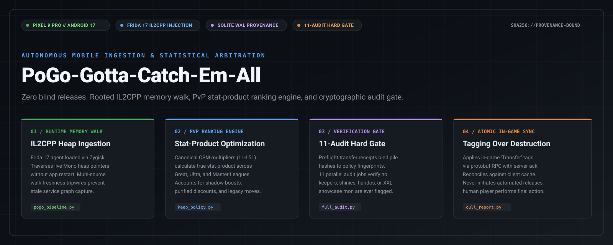
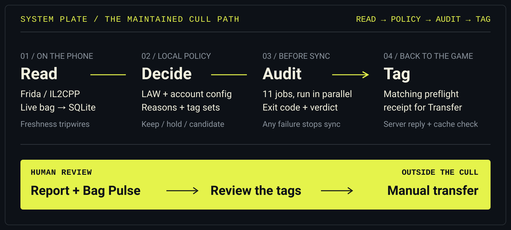
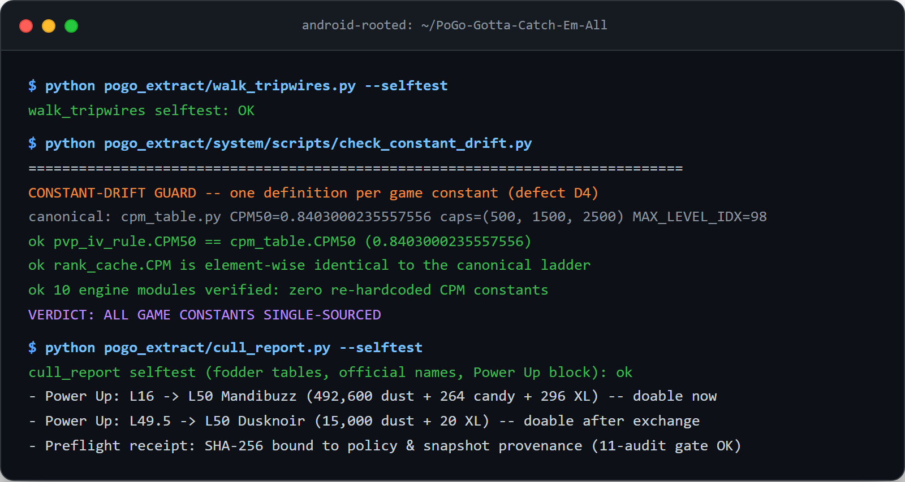
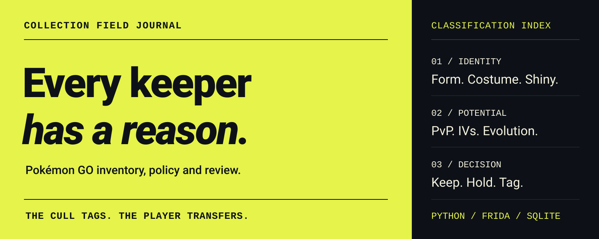

<div align="center">



# PoGo-Gotta-Catch-Em-All

### Autonomous, self-auditing Pokémon GO collection curation pipeline for rooted Android: IL2CPP runtime memory walk, PvP stat-product ranking engine, and 11-audit cryptographic hard gate.

[](https://www.android.com/)
[](https://store.google.com/product/pixel_9_pro)
[](https://github.com/topjohnwu/Magisk)
[](https://frida.re)
[](https://www.sqlite.org/)
[](https://www.python.org/)

[](https://github.com/BennyWaitWhat/PoGo-Gotta-Catch-Em-All/actions/workflows/ci.yml)
[](pogo_extract/full_audit.py)
[-brightgreen)](pogo_extract/system/scripts/prune_tags.py)
[](LICENSE)

[System Architecture](#-system-architecture) • [The Engineering Problem](#-the-engineering-problem) • [Core Pipeline](#-core-pipeline-mechanics) • [11-Audit Gate](#-the-11-audit-cryptographic-gate) • [Visual Proof](#-verified-visual-proof) • [Offline Verification](#-offline-verification--self-tests)

</div>

---

## ⚡ Executive Summary

**PoGo-Gotta-Catch-Em-All** is an autonomous collection management and statistical arbitration system built for rooted Android (**Pixel 9 Pro / Android 17**). It intercepts and inspects the live runtime memory of **Pokémon GO (0.429.1)** via an injected **Frida 17** gadget, extracts complete inventory state (~5,700 items) into an immutable SQLite WAL database, computes competitive PvP stat-product rankings with canonical CP multipliers, and enforces an **11-audit hard gate** before synchronizing in-game tags via Protobuf RPC.

The pipeline operates under a strict safety invariant: **zero automated releases**. The software identifies candidate transfers, validates them against multi-source freshness tripwires and regression test suites, tags them atomically in-game, and outputs an audit receipt for final player confirmation.

---

## 🔬 The Engineering Problem

Operating an inventory pipeline directly against a production mobile Unity / IL2CPP game environment introduces three core systems-engineering challenges:

1. **Transient Runtime Memory & Obfuscated Heap Layouts**:
   Unity's IL2CPP compiles C# code to native ARM64 assembly, stripping symbol tables and packing internal object layouts into dynamic Mono heap structures. Standard memory scraping risks application crashes, garbage collection deadlocks, or reading partially mutated pointers during active catching sessions.
2. **Silent Staleness & Service Graph Rebuilds**:
   The game engine frequently rebuilds internal service graphs without restarting the parent process. A naive memory walk can successfully extract consistent-looking data from an abandoned object graph, creating an illusion of validity while operating on obsolete collection state.
3. **Irreversible Destruction Risk**:
   Transferring a Pokémon in Pokémon GO is irreversible. A single false positive on an IV calculation, a misclassified costume form, a overlooked legacy move, or a top-ranked PvP stat product (e.g. Rank 1 Great League spread) results in permanent asset loss.

---

## 🏗️ System Architecture

The pipeline processes collection data across four decoupled stages, isolating phone-bound extraction from offline policy arbitration and atomic tag synchronization:

<div align="center">
  
</div>

### 1. Runtime Injection & IL2CPP Memory Walk (`pogo_extract/pogo_pipeline.py`, `pogo_extract/pogo_il2cpp.py`)
- **Frida 17 Gadget**: Injected via ZygiskFrida (`127.0.0.1:27047`), binding directly into `com.nianticlabs.pokemongo` without placing the game on Magisk's DenyList.
- **Single-Attach Traversal**: Replaces multi-step process chains with a unified attach. Traverses `PokemonBagImpl` getters in compiled C (`LV_SRC`) to avoid JavaScript engine deadlocks during concurrent engine garbage collection.
- **Multi-Source Freshness Tripwires (`pogo_extract/walk_tripwires.py`)**: Cross-references phone epoch timestamps, database scan timestamps (`MAX(last_scanned)`), and background catcher counters to confirm that the service graph is actively receiving live game updates.

### 2. PvP Stat-Product Arbitration Engine (`pogo_extract/system/scripts/keep_policy.py`)
- **Canonical CPM Constants (`pogo_extract/system/scripts/cpm_table.py`)**: Single-sources all Combat Power Multipliers (L1.0 through L51.0, including `CPM50 = 0.8403000235557556`) and league caps (500 CP Little, 1500 CP Great, 2500 CP Ultra). Verified across 10 engine modules by `check_constant_drift.py` to prevent multi-file constant drift.
- **Comb-Up Evolution Simulation**: Recursively computes the stat product for every legal evolutionary branch. If an unevolved Pokémon can evolve into a superior PvP contender compared to an existing keeper, it is promoted and protected.
- **Multi-Factor Keeper Matrix**: Enforces strict retention for 100% IVs (hundos), 0% IVs (nundos), legacy movesets, lucky variants, costume forms, XXL/XXS showcase scores, and shadow/purified variants.

### 3. Cryptographic Provenance & Preflight Binding (`pogo_extract/system/scripts/preflight_transfer.py`)
- **Database Content Hashing**: Computes a normalized SHA-256 fingerprint (`db_content_sha256`) across database rows rather than file modification time, ensuring SQLite WAL checkpoints do not invalidate valid policy decisions.
- **Immutable Provenance (`pile_provenance.json`)**: Binds candidate transfer sets to specific database content hashes and policy fingerprints.
- **Signed Preflight Receipt**: Authorizes tag synchronization only when the candidate pile SHA-256 precisely matches the output of the audit gate.

### 4. Atomic Tag Synchronization & Human Verification (`pogo_extract/system/scripts/prune_tags.py`)
- **Protobuf RPC Tagging**: Dispatches tag mutations in validated batches and waits for explicit server acknowledgment (`Success`).
- **Cache Reconciliation**: Post-push verification re-reads the client tag cache to ensure local state reflects server truth.
- **Zero Automated Releases**: No release API exists in the codebase. Tagged candidates appear under the in-game `Transfer` tag, allowing the human trainer to inspect and execute the batch release manually.

---

## 🛡️ The 11-Audit Cryptographic Gate

Before any in-game tag write is permitted, `pogo_extract/full_audit.py` executes 11 independent, read-only verification jobs concurrently. A failure in any single audit triggers an immediate hard stop:

| # | Audit Job | Source Script | Pass Condition / Invariant |
|---|---|---|---|
| **01** | **8-Layer Cull Audit** | `pogo_extract/audit_cull.py` | `ALL LAYERS PASS` — Confirms no trophy, hundo, shiny, legendary, or costume mon is present in the transfer pile. |
| **02** | **Tag Membership Audit** | `pogo_extract/audit_tags_membership.py` | `ALL TAG MEMBERSHIPS CORRECT` — Re-derives all tag assignments against the policy rulebook. |
| **03** | **Evolution Comb-Up Audit** | `pogo_extract/_evocheck.py` | `none of the tagged mons would improve` — Asserts that no candidate transfer could evolve into a superior rank. |
| **04** | **Keep Law Re-Derivation** | `pogo_extract/_lawcheck.py` | `UNEXPLAINED: 0` — Independent algebraic verification that every kept mon has a lawful keep reason. |
| **05** | **Label Law Audit** | `pogo_extract/audit_labels.py` | `ALL LABELS LAWFUL` — Confirms display labels correspond strictly to documented game state. |
| **06** | **Evolution Promises Audit** | `pogo_extract/audit_promises.py` | `ALL PROMISES HOLD` — Sandboxes evolution advice to ensure post-evolution stats match predictions. |
| **07** | **Game Master Consistency** | `pogo_extract/audit_gamemaster.py` | `GAME MASTER CONSISTENT` — Validates protobuf game master definitions against PvPoke and PokeMiners schemas. |
| **08** | **Rank Tag Accuracy** | `pogo_extract/audit_rank_tags.py` | `EVERY RANK TAG CHECKS OUT` — Verifies Great and Ultra League PvP ranks against exact CPM multipliers. |
| **09** | **Tag Truth Verification** | `pogo_extract/audit_tag_truth.py` | `EVERY TAG IS TRUE` — Audits every applied tag directly against the monster's live memory attributes. |
| **10** | **Structural Invariants** | `pogo_extract/audit_invariants.py` | `ALL STRUCTURAL INVARIANTS HOLD` — Asserts schema models, enum bounds, and category constraints. |
| **11** | **PvP Keeper Regression** | `pogo_extract/system/scripts/regress_pvp_keepers.py` | `ALL PVP KEEPER FIXTURES KEPT` — Sandboxes historical keeper test fixtures to guarantee zero regression false positives. |

---

## 📊 Verified Visual Proof

The execution capture below displays the live test suite validating inventory freshness tripwires, constant drift single-sourcing, and cull report generation:

<div align="center">
  
</div>

### Collection Philosophy & Classification
Every preserved Pokémon is anchored to an explicit, reviewable rationale:

<div align="center">
  
</div>

---

## 🗂️ Codebase Architecture

```
PoGo-Gotta-Catch-Em-All/
├── assets/                           # High-contrast vector artwork & authentic terminal captures
│   ├── hero.svg                      # Custom avant-garde repository hero banner
│   ├── review-pipeline.svg           # High-contrast 4-pillar architectural system plate
│   ├── field-journal.svg             # Editorial collection classification plate
│   └── cull_report_terminal.png      # Retina terminal capture of verified test executions
├── pogo_extract/                     # Core collection curation & memory extraction engine
│   ├── pogo_pipeline.py              # Single-attach Frida IL2CPP heap reader & database builder
│   ├── pogo_il2cpp.py                # Native IL2CPP type mapping & ARM64 bridge
│   ├── walk_tripwires.py             # Multi-source memory freshness verification
│   ├── full_audit.py                 # 11-audit parallel gate coordinator & tag synchronization
│   ├── cull_report.py                # Human-readable differential report generator
│   ├── system/scripts/               # Policy rules, CPM constants, and cryptographic provenance
│   │   ├── keep_policy.py            # Primary curation rulebook & stat-product calculation
│   │   ├── cpm_table.py              # Canonical Combat Power Multiplier reference (L1-L51)
│   │   ├── check_constant_drift.py   # Guard script verifying single-sourced game constants
│   │   ├── preflight_transfer.py     # Cryptographic receipt builder for Transfer tag writes
│   │   └── prune_tags.py             # Atomic in-game tag synchronization engine
│   ├── LAW.md                        # Formal specification of collection retention rules
│   └── RUNBOOK.md                    # Operational guide for manual verification and passes
├── AutoCatcher/                      # Optional on-device automation (manual opt-in)
│   ├── README.md                     # Architecture of background catching and crash recovery
│   └── tools/GYM.md                  # Specification for gym interaction and buddy routines
├── tools/                            # System-level auditing & data persistence utilities
│   ├── triple_check.py               # Pre-commit integrity gate (compilation, tests, secrets)
│   └── pogo_data.py                  # Phone data store synchronization utility
└── docs/                             # Engineering specifications & setup guides
    ├── cloud_setup.md                # Rooted phone network bridge configuration
    ├── data.md                       # Data ownership & phone store storage layout
    ├── phone_access.md               # ADB permission boundaries & security restrictions
    ├── START_HERE.md                 # Technical overview for new environments
    ├── HANDOFF.md                    # Engineering logs & state machine checkpoints
    └── CHANGELOG.md                  # Evolution of the curation pipeline
```

---

## 🧪 Offline Verification & Self-Tests

The repository enforces offline self-tests that run without an attached phone or live database:

```bash
# 1. Verify phone data store manifest integrity
python tools/pogo_data.py selftest

# 2. Run freshness tripwire engine self-test
python pogo_extract/walk_tripwires.py --selftest

# 3. Verify single-sourced game constants (Defect D4 check)
python pogo_extract/system/scripts/check_constant_drift.py

# 4. Verify cull report formatting and power-up budget math
python pogo_extract/cull_report.py --selftest

# 5. Verify game master parser offline integrity
python pogo_extract/system/scripts/refresh_gamemaster.py --selftest

# 6. Verify gym battle damage calculations
python AutoCatcher/tools/test_gym_stab.py

# 7. Run full pre-commit triple-check suite
python tools/triple_check.py
```

---

## ⚙️ Hardware & Environment Requirements

| Component | Tested Environment | Purpose |
|---|---|---|
| **Device** | Google Pixel 9 Pro | Target ARM64 execution platform |
| **Operating System** | Android 17 (Vanilla Ice Cream) | Mobile OS environment |
| **Root Solution** | Magisk 30.7 + Zygisk | Device privilege escalation & runtime injection |
| **Hook Engine** | Frida 17.9.11 + ZygiskFrida 1.9.0 | IL2CPP memory walk without DenyList conflict |
| **Target App** | Pokémon GO 0.429.1 | Production game binary |
| **Integrity Suite** | Play Integrity Fix + Shamiko | Environmental root hiding |
| **Network Bridge** | Tailscale 1.102 + ADB over Wi-Fi (:5555) | Secure, encrypted transport to phone shell |
| **Runtime** | Python 3.11+ / 3.12 | Local curation engine execution |

---

## ⚠️ Security, Safety & Legal Disclaimer

- **Zero In-Game Release Primitive**: This software does not contain any code capable of transferring or deleting Pokémon. It writes descriptive tags (`Transfer`, `Best GL`, `Power Up to 1500`) directly to the game's tagging system. The user must manually review and confirm any batch transfer within the official Pokémon GO client.
- **Account Risk**: Modifying memory or running automation on Pokémon GO violates Niantic's Terms of Service and may result in account penalties or permanent bans. This repository is provided strictly for educational and reverse-engineering research purposes.
- **Intellectual Property**: Pokémon and Pokémon GO are registered trademarks of Nintendo, Creatures Inc., GAME FREAK inc., and Niantic, Inc. This project is independent and has not been authorized, sponsored, or approved by the trademark holders.
