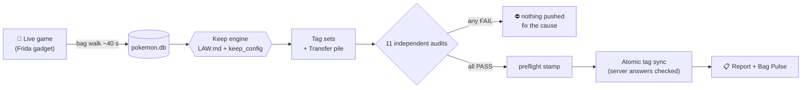
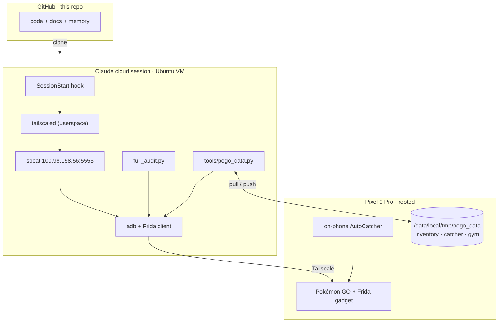

<div align="center">


**A self-auditing Pokémon GO collection manager for one rooted Pixel.**<br>
It reads every Pokémon straight out of the running game, decides what is worth keeping under a written law,
proves that decision with eleven independent audits, and tags the rest for Benny to release by hand.
**It never releases anything itself.**

[](https://github.com/BennyWaitWhat/PoGo-Gotta-Catch-Em-All/actions/workflows/ci.yml)


-critical)


[Quick start](#-quick-start) · [How it works](#-how-it-works) · [Safety model](#%EF%B8%8F-safety-model) · [Architecture](#%EF%B8%8F-architecture) · [Repository map](#-repository-map) · [Docs](#-documentation)

</div>

---

## ✨ Highlights

- **Reads the live game, not a screenshot.** A Frida/IL2CPP walk pulls the whole bag — about 5,700 Pokémon with IVs, forms,
  costumes, sizes, moves, tags and backgrounds — into SQLite in roughly 40 seconds.
- **A written keep law.** [`pogo_extract/LAW.md`](pogo_extract/LAW.md) says what a keeper is (PvP rank ≤ 5 per stage and league,
  hundos, shinies, costumes, XXL showcase entries, Adventure Effects, legacy moves, per-line ladders…); the caps live in one config.
- **Eleven audits stand in front of the only irreversible output.** Each re-derives the pile its own way; one failure and nothing
  is pushed to the phone.
- **Tags, never releases.** The result goes back as the game's own tags — `Transfer` is the pile. Benny releases by hand.
- **Explains itself.** Every cull ends with what improved, why each Pokémon is in the pile ("lost its ladder slot to the
  just-caught 98% Smoliv"), a PvP safety check and which way to evolve.
- **Cloud-native.** Claude cloud sessions reach the phone over Tailscale; the game data lives on the phone and moves with a
  versioned, checksummed pull/push.

## 🚀 Quick start

**Benny, once:** set up the cloud environment (≈15 min) — [`docs/cloud_setup.md`](docs/cloud_setup.md). Then open a session on this
repo in that environment and say **`cull`**.

**A session, every cull** (the `/cull` skill does exactly this):

```bash
python tools/pogo_data.py pull                    # game data: phone -> this checkout
cd pogo_extract && python full_audit.py           # walk -> keep law -> 11 audits -> tag sync -> report
cd .. && python tools/pogo_data.py push --group inventory   # data back to the phone
```

Every session reads [`docs/START_HERE.md`](docs/START_HERE.md) first — the SessionStart hook prints it automatically.

## 🧭 How it works



1. **Walk** — `pogo_pipeline.py` attaches once, reads the live inventory service graph and reconciles `pokemon.db`.
   Walk tripwires stop the pass (rc 8) on a frozen or impossible read.
2. **Judge** — `system/scripts/keep_policy.py` applies the law; `build_tagsets.py` turns decisions into tag sets.
3. **Prove** — `full_audit.py` runs the 11 audits in parallel: 8-layer cull, tag membership, evo comb-up, law re-derivation,
   label law, promises, game master, rank tags, tag truth, structural invariants and the PvP keeper fixtures.
4. **Push** — only through `preflight_transfer.py` → `prune_tags.py --atomic`, and only with a fresh matching stamp.
   Every batch's server answer is recorded; a refusal fails the write.
5. **Report** — `cull_report.py` writes the human report; `gen_bag_pulse.py` renders the Bag Pulse page.

## 🛡️ Safety model

| Promise | How the code enforces it |
|---|---|
| Never releases a Pokémon | Tag-only by design; no release code ships in this repo (`bulk_release` and friends are kept out by `.gitignore`) |
| One route to the pile | `tag_ops.is_pile_tag` refuses `Transfer` everywhere except `prune_tags --atomic` with a fresh `preflight_stamp` |
| A wrong pile never reaches the phone | The 11-audit hard gate: `AUDIT GATE FAILED` means the sync did not run |
| Never restarts the game | `verify_tags_live.restart_pogo()` raises; the cull is cache-verified |
| Never judges stale or missing data | Walk tripwires (rc 8); `full_audit.py` refuses without a real `pokemon.db`; unknown = protected |
| Never guesses a flag | `full_audit.py` refuses unknown arguments (rc 2, "NOTHING was run") |
| Nobody pauses anybody | The phone busy marker is advisory; the on-phone catcher, gym runs and culls overlap by design |
| Data never silently lost | Per-group versions, sha256 on the phone, atomic renames, newer-local-file refusal — [`docs/data.md`](docs/data.md) |
| No secrets in git | Whitelist `.gitignore` files + a CI secret scan — [`SECURITY.md`](SECURITY.md) |

## 🏗️ Architecture



## 🗂️ Repository map

| Path | What |
|---|---|
| [`pogo_extract/`](pogo_extract/) | **Bag curation** — walk, keep engine, audits, tag sync, reports. Humans: [`README`](pogo_extract/README.md) · sessions: [`CLAUDE.md`](pogo_extract/CLAUDE.md) · the law: [`LAW.md`](pogo_extract/LAW.md) |
| [`AutoCatcher/`](AutoCatcher/) | **The on-phone catcher** plus desktop research tools and the gym/buddy runners — [`README`](AutoCatcher/README.md), [`GYM.md`](AutoCatcher/tools/GYM.md) |
| [`docs/`](docs/) | Orientation, cloud setup, the data store, phone etiquette, and 113 memory notes (standing rules + incident write-ups) |
| [`tools/`](tools/) | `pogo_data.py` — the phone data store (pull / push / status) |
| [`cloud/`](cloud/) | `setup.sh` — the cloud environment's setup script |
| [`pokegenie_work/`](pokegenie_work/) | PokeGenie backup tooling (regenerates its collection and art from `pokemon.db`) |
| [`.claude/`](.claude/) | The phone-bridge SessionStart hook and the `/cull` skill |

## 🤝 Sessions and ownership

Three long-running Claude sessions share the repo; each file has exactly one owner.

| Session | Owns |
|---|---|
| **Pokemon Inventory** | `pogo_extract/`, `docs/`, `tools/`, `cloud/`, `.claude/`, root files; data groups `inventory`, `inventory-cold` |
| **AutoCatcher** | `AutoCatcher/` (except the gym files); data group `catcher` |
| **Gym Battle** | `AutoCatcher/tools/gym_*`, the buddy/gym tappers; data group `gym` |

Work goes branch → PR → squash-merge. See [`CONTRIBUTING.md`](CONTRIBUTING.md).

## 📚 Documentation

| Doc | For |
|---|---|
| [`docs/START_HERE.md`](docs/START_HERE.md) | Every session, first — roles, start/end of work, the rules |
| [`docs/cloud_setup.md`](docs/cloud_setup.md) | Setting up the cloud environment; fixing the phone bridge |
| [`docs/data.md`](docs/data.md) | The phone data store: groups, guarantees, commands |
| [`docs/phone_access.md`](docs/phone_access.md) | Who attaches what, the advisory busy marker |
| [`docs/memory/INDEX.md`](docs/memory/INDEX.md) | Standing rules and the incident behind each one |
| [`CHANGELOG.md`](CHANGELOG.md) | What changed, release by release |

## 📜 License

All rights reserved — see [`LICENSE`](LICENSE). Pokémon and Pokémon GO are trademarks of their respective owners; this is a
personal project, not affiliated with or endorsed by Nintendo, The Pokémon Company, Niantic or Scopely.
