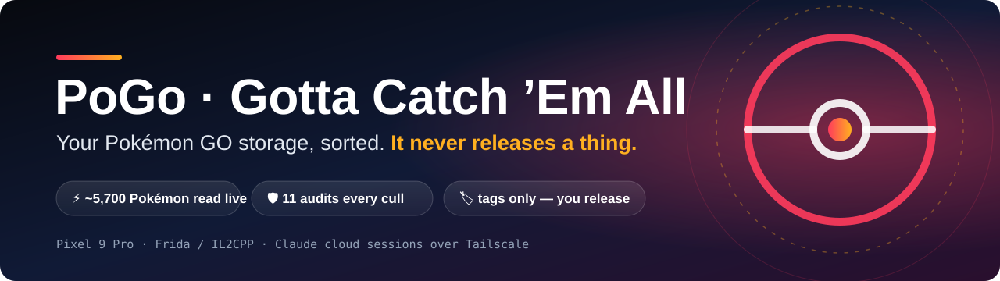
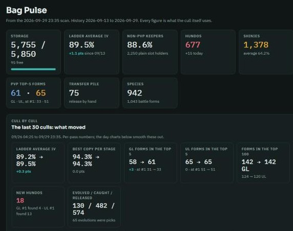
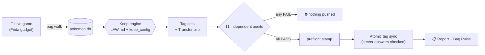
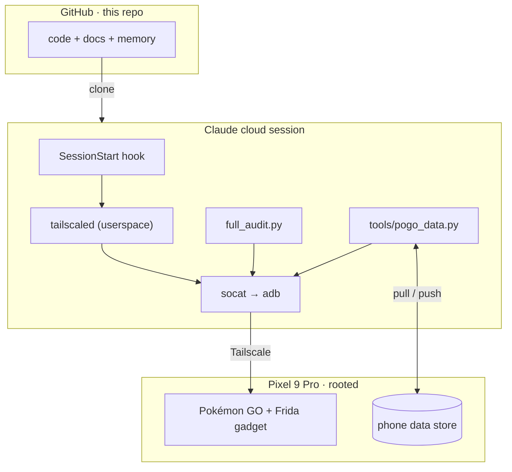

<div align="center" id="top">



### Say **“cull”**. Get back a tagged bag and a one-page report. Release the junk in two taps.

[](https://github.com/BennyWaitWhat/PoGo-Gotta-Catch-Em-All/actions/workflows/ci.yml)


-critical)


[What it does](#-what-it-does) · [What you need](#-what-you-need) · [Set it up](#-set-it-up) · [What it keeps](#-what-it-always-keeps) · [Tags](#%EF%B8%8F-the-tags-youll-see-in-game) · [Report](#-a-real-report) · [Safety](#%EF%B8%8F-why-its-safe) · [Troubleshooting](#-troubleshooting) · [FAQ](#-faq)

</div>

> [!IMPORTANT]
> **📱 Needs a rooted Android phone.** Not for iPhone, and not for an unrooted phone.
> Tested on a Pixel 9 Pro · Android 17 with Magisk, ZygiskFrida (a Frida gadget inside Pokémon GO) and Tailscale,
> plus a Claude Code account to run it. **[Everything you need →](#-what-you-need)**

---

## 🎯 The short version
For Pokémon GO players on a **rooted Android** phone.
Your bag fills up. Deciding what to transfer means checking IVs, PvP ranks, shinies, costumes, sizes and evolutions —
thousands of times. This does all of it for you, straight from the game's own data, and marks the throwaways with a
**Transfer** tag. You open Pokémon GO, search the tag, select all, transfer. Done.

**You do three things:**
1. Say **`cull`** to the cloud session.
2. Read the report (what improved, what's in the pile and why).
3. In the game: search **`Transfer`** → select all → transfer.

Every cull also refreshes **Bag Pulse**, your collection at a glance:

<div align="center"></div>

## ⚡ What it does
**Sorting**
- 🔍 **Reads your whole bag live** — ~5,700 Pokémon in about 2 minutes: IVs, form, costume, size, moves, background, shiny, shadow, lucky, Dynamax.
- 🧠 **Decides keepers with a written rulebook** ([`LAW.md`](pogo_extract/LAW.md)) — the same rules every time, per species, per form, per gender look.
- ⬆️ **Combs up automatically** — catch a better copy and the worse one drops to the pile ("lost its slot to the just-caught 98% Smoliv").
- 🏷️ **Tags everything in the game itself** — the tags show up on your Pokémon, so you can search and act in two taps.

**Advice**
- 🧬 **Tells you what to evolve and which way** — "Applin 87% → Flapple, not Appletun (needs 20 Tart Apples)"; "evolve once, then STOP".
- 💪 **Tells you what to power up** — to the Great (1,500) or Ultra (2,500) League cap — and which ones deserve a second charged move.
- 🍬 **Only suggests what you can afford** — reads your real candy and items; if you're short, the Pokémon is held, never tossed.
- 🤝 **Picks good trade bait** — the best of what's left gets a Remote Trade tag, never your worst copies.

**Tracking**
- 📋 **A one-page report after every cull** — what improved, why each Pokémon is in the pile, a PvP safety check, which way to evolve.
- 📈 **Bag Pulse** — ladder %, hundos, shinies, PvP standing and the last 30 culls, updated every pass.
- 👥 **Two accounts** — separate rules and data for the main and the alt; switch with one command.
- 🗂️ **PokeGenie sync** — rebuilds PokeGenie's collection from the same data, with official art.

**Safety**
- 🛡️ **11 independent checks before anything is tagged** — any failure and nothing touches your phone.
- 🙅 **Never releases, never restarts your game, never pauses your catcher** — hard rules in the code, not promises.
- ✅ **Confirms with the game's server** — every tag write is checked against the server's answer.

**Automation (off unless you say “go”)**
- 🎣 **AutoCatcher** — an on-phone catcher with a crash breaker, plus a Field Research reward collector and an event-apple collector.
- 🏟️ **Gym & buddy runners** — native gym battles, berry feeding, buddy hearts. Every run needs your explicit go.

**Runs itself**
- ☁️ **Lives in Claude cloud sessions** — they reach your phone over Tailscale, keep the game data on the phone, and hand off cleanly between sessions.

## 🧰 What you need
| You need | Tested with | Why |
|---|---|---|
| An **Android phone with root** (Magisk, Zygisk on) | Pixel 9 Pro · Android 17 · Magisk 30.7 | The tools read the running game |
| **ZygiskFrida** loading a Frida 17 gadget into Pokémon GO, in listen mode on `127.0.0.1:27047` ([config](AutoCatcher/ondevice_toggle/config.listen.so)) | ZygiskFrida v1.9.0 | How the tools talk to the game. Pokémon GO must **not** be on Magisk's DenyList |
| **Pokémon GO** | 0.429.1 | The game |
| **Root hiding** | Shamiko + Play Integrity Fix | Keeps the game happy on a rooted phone |
| **Tailscale** on the phone | 1.102 | Lets the cloud reach your phone from anywhere |
| **adb over Wi-Fi** on port 5555, switched on at every boot | a 3-line Magisk boot script ([how](docs/cloud_setup.md#phone-prerequisites-once)) | The cloud's line to the phone |
| **Claude Code on the web** + a **GitHub** account | Opus 5.5 · Max plan | The sessions that run everything |
| *Automation only:* **Termux** + Termux:Boot, **GPS Joystick**, **Pokemod** | Termux 0.119 · GPS Joystick 5.3.3 · Pokemod 13.3.3 | On-phone catcher, movement, virtual Go Plus |
| *Optional:* **PokeGenie** | — | PokeGenie sync |

No PC needed day to day — the phone and a browser are enough.

## 🚀 Set it up
1. **Phone:** root, ZygiskFrida + the listen config, root hiding, Tailscale, adb over Wi-Fi at boot — [phone prerequisites](docs/cloud_setup.md#phone-prerequisites-once).
2. **Repo:** connect this repository in [claude.ai/code](https://claude.ai/code) (authorize the Claude GitHub app for it).
3. **Cloud environment:** Full network, the [setup script](cloud/setup.sh), and three keys (Tailscale + a cloud-only adb key) — [step by step](docs/cloud_setup.md).
4. **Data:** the game data lives on the phone ([how](docs/data.md)); the first session pulls it automatically.
5. **Go:** start a session in that environment and say **`cull`**. The first time, your phone asks *Allow USB debugging?* — tick *Always allow*, tap *Allow*.

## 🏆 What it always keeps
One rulebook, checked top to bottom — the first rule that fits decides. Caps are yours to set per account.

| Kept | Why |
|---|---|
| 💯 **Hundos, nundos, legacy moves, Mighty** | Trophies — one per look (form, shiny, shadow, costume, background, size, lucky) |
| ⚔️ **PvP top-5 spreads** | Rank 1–5 in Great or Ultra League at a stage that can actually get there — plus your best copy per league, within your rank cut-off |
| 🌟 **Legendaries, mythicals, Ultra Beasts, Paradox** | Your top copies per variant |
| ✨ **Shinies** | Your top copies per species and form (shinies comb up by IV too) |
| 🎭 **Costumes, Dynamax, Gigantamax** | Your top copies per costume or Max form |
| 🖼️ **Special backgrounds & location cards** | Your top copies per card |
| 🌑 **Shadows** | Your best Ultra and Master League shadow per species |
| 📏 **XXL** | Your highest-scoring showcase contender per species |
| ♀️♂️ **Gender looks** | Different-looking males and females each get their own ladder |
| 🪜 **Everything else** | A small ladder per species: the best few at each stage, by IV |

Anything unclear — a missing rank, a stale read — is **kept**, never tossed.

## 🏷️ The tags you'll see in game
| Tag | What it means for you |
|---|---|
| **Transfer** | Safe to release — checked against every rule above. Search it, select all, transfer. |
| **Evolve Once · Evolve Twice** | Evolve this one — one step, or all the way. You can afford it now. |
| **Evolve Gated** | Worth evolving, but it needs an item or condition first (the report says which) |
| **Evo Best GL · Evo Best UL** | Evolve it to get your best Great / Ultra League copy |
| **Best GL · Best UL · Best ML** | Already your best copy for that league |
| **GL / UL Rank 1-5** · **Evo GL / UL Rank 1-5** | A top-5 PvP spread — now, or after evolving |
| **Power Up to 1500 · 2500** | Power it up to the league cap |
| **Unlock 2nd Move** | Worth a second charged move |
| **Hundo · Nundo · 0-15-15** | 100% · 0% · the classic PvP spread |
| **XXL** | Your top showcase contender |
| **Legacy Moves · Adventure Effect · Ultra Beast** | Rare moves or a rare Pokémon — kept |
| **Shiny - Only One · Shiny #4+ · Variant #1–#4+** | Where it sits in its shiny / variant ladder |
| **Remote Trade** | Good trade bait from what's left |
| **Never Cull · Safety Hold** | You said keep it · held back on purpose while something is unclear |

## 📋 A real report
From the first cloud cull (2026-09-29, 23:35):
```
Release the 75 in the Transfer tag. All 11 audits pass, 0 BLOCK / 0 WARN.
Bag 5,756/5,850 (94 free) · 67 tag changes pushed, server answered Success

What improved
  93% Foongus (just caught) — new best at its stage: Best ML, Best UL. Replaces your 84% Foongus
  87% Snorlax (just caught) — legacy-move slot. Replaces your 82%

Why each one is in the pile
  84% Stufful — lost its ladder slot to the just-caught 89% Stufful
  31% Nickit  — lost its ladder slot to the just-caught 80% Nickit

Safety check: all 75 checked in every league and every stage they can evolve into. None is in any top 5.

Which way to evolve
  Applin 87% → Flapple, not Appletun / Dipplin (needs 20 Tart Apples)
  Rolycoly 82% → Carkol, then STOP
```

## 🛡️ Why it's safe
- **It only tags.** Releasing is always your tap. There is no release code in this repo.
- **11 independent audits** re-check the pile their own way before anything is written. One failure → nothing is pushed.
- **One door to the pile.** The Transfer tag can only be written through one guarded path, with a fresh signed-off check.
- **It never restarts your game** and never pauses the on-phone catcher.
- **Unknown = keep.** Missing or stale data protects a Pokémon; it never condemns one.
- **The game's server confirms** each tag write; a refusal is reported, not ignored.

## 🩺 Troubleshooting
| You see | Do this |
|---|---|
| `PHONE BRIDGE: NOT connected` | Match the log line in the [bridge table](docs/cloud_setup.md#when-the-bridge-says-not-connected-for-sessions) — usually the phone is asleep or Tailscale is off |
| *Allow USB debugging?* on the phone | Tick *Always allow*, tap *Allow*, tell the session "retry the bridge" |
| `SETUP INCOMPLETE` | Nothing — the session reinstalls what's missing by itself |
| `AUDIT GATE FAILED` | Nothing reached your phone. The session finds and fixes the cause, then re-runs |
| *An API error occurred* | Usually your weekly usage limit — try again after it resets |

## ❓ FAQ
**Will it ever release a Pokémon?** No. It can't — you release from the Transfer tag.
**What if it gets something wrong?** The 11 audits catch it before your phone sees it, and every pile Pokémon comes with its reason.
**Can I change what's kept?** Yes — ask. You get numbered options, you pick, the rulebook changes. Nothing changes silently.
**Does it work on my phone?** It's built for one rooted Pixel 9 Pro — see [what you need](#-what-you-need). It's personal tooling, not an app.

## 🗺️ Roadmap
- [ ] Fold Field Research reward catching into the catcher, so nothing ever pauses it
- [ ] Level-71 tracker: read the catch-medal counters on the obfuscated game build
- [ ] Lock the cloud down to the phone's adb port only (Tailscale tag + ACL)
- [ ] Back up the full snapshot archive to the phone store
- [ ] A first-run path for a brand-new phone (today it starts from an existing data set)

## ⚠️ Disclaimer
Root, memory reading and automation break Pokémon GO's Terms of Service, and accounts can be warned or banned —
this one has been. This is a personal project, shared as-is. Use it at your own risk.

---

## 🔧 Under the hood
<details>
<summary><b>For developers and Claude sessions — architecture, repo map, docs</b></summary>

### How a cull runs


### How the cloud reaches the phone


### Repository map
| Path | What |
|---|---|
| [`pogo_extract/`](pogo_extract/) | Bag curation: walk, keep engine, audits, tag sync, reports — [`README`](pogo_extract/README.md), [`CLAUDE.md`](pogo_extract/CLAUDE.md), [`LAW.md`](pogo_extract/LAW.md) |
| [`AutoCatcher/`](AutoCatcher/) | On-phone catcher, research tools, gym/buddy runners — [`README`](AutoCatcher/README.md), [`GYM.md`](AutoCatcher/tools/GYM.md) |
| [`docs/`](docs/) | [`START_HERE`](docs/START_HERE.md) (every session reads it first), [`HANDOFF`](docs/HANDOFF.md), [`cloud_setup`](docs/cloud_setup.md), [`data`](docs/data.md), [`phone_access`](docs/phone_access.md), [`CHANGELOG`](docs/CHANGELOG.md), [`memory/`](docs/memory/INDEX.md) |
| [`tools/`](tools/) | `pogo_data.py` + `data_manifest.txt` (the phone data store), `triple_check.py` (run before anyone says "done") |
| [`cloud/`](cloud/) · [`.claude/`](.claude/) | Environment setup script · phone-bridge hook, `/cull` skill, output style, skills |
| [`pokegenie_work/`](pokegenie_work/) | PokeGenie backup tooling |
| [`.github/`](.github/) | CI, issue/PR templates, [`CONTRIBUTING`](.github/CONTRIBUTING.md), [`SECURITY`](.github/SECURITY.md), [`SUPPORT`](.github/SUPPORT.md), [`CODE_OF_CONDUCT`](.github/CODE_OF_CONDUCT.md) |

**Sessions:** Pokemon Inventory (`pogo_extract/`, docs, tools), AutoCatcher (`AutoCatcher/`), Gym Battle (the gym/buddy files).
Work goes branch → PR → squash-merge; `python tools/triple_check.py --gate` must say ALL CLEAR.

</details>

## 🙏 Built with
[Frida](https://frida.re) · [ZygiskFrida](https://github.com/lico-n/ZygiskFrida) · [Magisk](https://github.com/topjohnwu/Magisk) ·
[PvPoke](https://pvpoke.com) (PvP rankings & game master) · [PokeMiners](https://github.com/PokeMiners/game_masters) (game master) ·
[s2sphere](https://github.com/sidewalklabs/s2sphere) · [Tailscale](https://tailscale.com) · [Claude Code](https://claude.com/claude-code)

## 📜 License
All rights reserved — see [`LICENSE`](LICENSE). Pokémon and Pokémon GO are trademarks of their respective owners; this is a
personal project, not affiliated with or endorsed by Nintendo, The Pokémon Company, Niantic or Scopely.

<div align="right"><a href="#top">↑ back to top</a></div>
